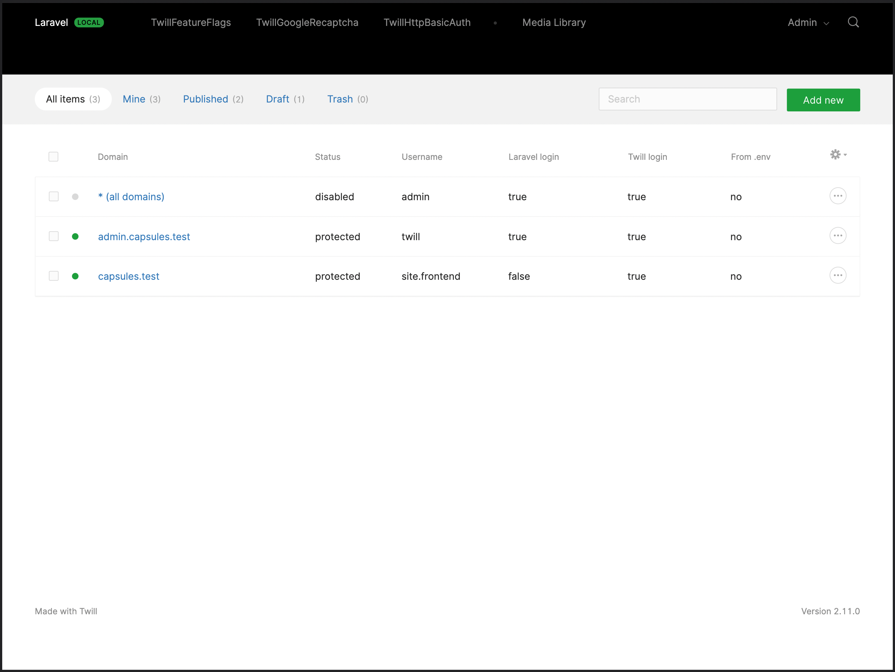
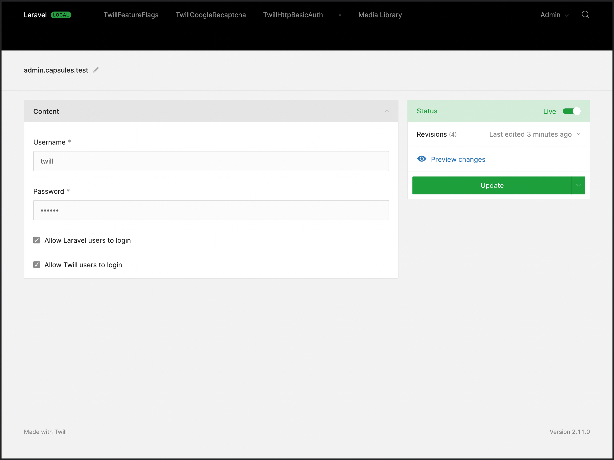

# HTTP Basic Auth Twill Capsule

[](https://github.com/antonioribeiro/twill-http-basic-auth/actions/workflows/tests.yml)

This Twill Capsule is intended to enable developers to configure Basic Auth on their applications. 





## Domains

You can add as many domains as you need and configure different passwords for each. You can have the https://site.com, for instance, unprotected to allow public access to it, and block access to https://origin.site.com and https://admin.site.com to only allow access to people with an account, and those that have access to the HTTP Basic Auth username and password. 

## One config for all

Once you enable the `all domains (*)` entry, the same configuration will be used for all domains available, and all other domain configurations will be hidden.

## Middleware

The middleware is **global**: it sees every request, whatever its route is. That is what keeps a protected host closed everywhere: the pages, the API, the admin, the image routes, `robots.txt`, a dashboard such as Horizon, the pages that do not exist and the automatic `OPTIONS` answers. It is pushed after the application's own global middleware, so proxies are trusted, and the host is known, before it decides.

``` php
'middleware' => [
    'automatic' => true,

    'class' => \A17\TwillHttpBasicAuth\Http\Middleware::class,
],
```

With `automatic` off you add `\A17\TwillHttpBasicAuth\Http\Middleware` yourself, where you want it.

Something has to stay open, such as a health check for a monitor? Name it in `ignore.paths` (`'paths' => ['up']`). Nothing is ignored by default.

## Using authentication

If you don't want to share a single username and password with everyone that will access your pages, you can configure the package to allow existing users, both on Twill (CMS) and/or Laravel (frontend), to use their own passwords to pass Basic Auth.

## Installing

## Supported Versions

Version 3 needs PHP 8.3+, Laravel 12 or 13 and Twill 3.5 or 3.6. It no longer depends on `area17/http-basic-auth`: that library is part of this package now. Upgrading from 2.x? Read the 3.0 notes in the [CHANGELOG](CHANGELOG.md).

Composer will manage this automatically for you, but these are the supported versions between Twill and this package. 

| Twill Version | Capsule version | Installing with Composer                             | 
|---------------|-----------------|------------------------------------------------------|
| 3.5 and 3.6   | 3.x             | composer require area17/twill-http-basic-auth:"^3.0" |
| 3.x           | 2.x             | composer require area17/twill-http-basic-auth:"^2.0" |
| 2.x           | 1.x             | composer require area17/twill-http-basic-auth:"^1.0" |

### Require the Composer package:

``` bash
composer require area17/twill-http-basic-auth
```

### Publish the configuration

``` bash
php artisan vendor:publish --provider="A17\TwillHttpBasicAuth\ServiceProvider"
```

### Load Capsule helpers by adding calling the loader to your AppServiceProvider:

``` php
/**
 * Register any application services.
 *
 * @return void
 */
public function register()
{
    \A17\TwillHttpBasicAuth\Services\Helpers::load();
}
```

#### Configuring via the `.env` file

The credentials of the `.env` are used only when the package is enabled (the flag reads `1`, `true`, `yes` or `on`):

```dotenv
TWILL_HTTP_BASIC_AUTH_ENABLED=true
```

You can configure credentials both via CMS settings or on the `.env` file. If you set them on `.env` (and enable the package) they protect every host and the list of the admin is read-only. Without them, or with the package disabled, the published rows of the admin list decide, host by host (a row protects its own host, or every host if its domain is `*`), whatever `ENABLED` says.

```dotenv
TWILL_HTTP_BASIC_AUTH_USERNAME=frontend
TWILL_HTTP_BASIC_AUTH_PASSWORD=secret
```

### Database login 
You can configure the package to allow users pass HTTP Auth Basic with their existing email and password, by just enabling the feature on the `.env` file:   

```dotenv
TWILL_HTTP_BASIC_AUTH_TWILL_DATABASE_LOGIN_ENABLED=true
TWILL_HTTP_BASIC_AUTH_LARAVEL_DATABASE_LOGIN_ENABLED=true
```

### Rate limiting

Guessing is slowed down. Only **failed** attempts count, one counter per visitor (IP address) and host: a correct login never counts and clears the counter, and one visitor cannot lock another out. Past the limit the answer is `429` with `Retry-After` for the rest of the minute. The default is 10 failures a minute:

```dotenv
TWILL_HTTP_BASIC_AUTH_RATE_LIMITING_ATTEMPTS=10
```

(`rate-limiting.attemps-per-minute` of 2.x is now `rate-limiting.attempts-per-minute`.)

By requiring users to have an enabled account in Twill (or Laravel) to access a protected website, this becomes an additional security feature. It also allows you to avoid disclosing the same username and password to everyone who is authorized to view the site.  

## Security

What the package guarantees, and what the test suite checks:

- **Fails closed.** A protected host whose credentials cannot be used (an empty or undecryptable password, half of the `.env` pair) answers `503` and logs an error. It never answers `200`.
- **Constant-time comparison** (`hash_equals` on a digest of each field) and **no default credentials**: there is no `usern@me / passw0rt` any more.
- **Passwords are stored encrypted, shown never.** The admin form does not get the password back, saving it empty keeps the stored one, and no revision keeps it (revisions are off for this module). A value that cannot be decrypted is an error, not a plain-text password.
- **Not cacheable.** Every 401, 429, 503 and every response behind the password carries `Cache-Control: no-store, private`.
- **Closed everywhere, open nowhere by default**: a global middleware and an empty `ignore.paths`.
- **Guessing is slowed down**, per visitor and host, counting failures only (see Rate limiting). A request with no credentials, such as the browser's first one, is asked and not counted.
- **Resolved per request**, kept on the request: nothing is carried over between requests, so it is safe under Octane.
- **No session is created by Basic Auth.** The optional database logins check the credentials with the guard's `validate()` and a visitor's session is never looked at: the password is asked before any session starts. The Twill login only lets `published` accounts in.

What it cannot do for you:

- **A row protects a host name, not the application.** A row for `staging.example.com` leaves `www.staging.example.com`, or any other name the server answers to, open. For a whole site use the `*` row or the `.env` credentials.
- **The host is `Request::getHost()`**, and the visitor's address is `$request->ip()`. Both are only as true as your trusted proxies (Laravel's `TrustProxies`): trust your CDN's addresses, never `*`, and never loopback on a machine that clients reach directly. A forged `X-Forwarded-Host` is believed from a trusted proxy; a forged `X-Forwarded-For` lets a client choose the address the rate limit counts. Behind a proxy that is not trusted, every visitor has the proxy's address and shares one counter.
- **The rate limit needs a cache that lasts between requests** (Redis, database or file). With the `array` store every request starts from zero and nothing is ever limited.
- **Run `php artisan migrate`**: version 3 adds a migration (the credential columns become `text`: an encrypted value is longer than 255 characters). Without the table the middleware cannot read the rows and the request fails.

## Development

```sh
composer install && npm install
composer test        # vendor/bin/phpunit (fails on deprecations, warnings, risky and skipped tests)
composer lint        # PHPStan, level max, on src and Tests
vendor/bin/php-cs-fixer fix --dry-run --diff --config=.php-cs-fixer.dist.php --allow-risky=yes
npx prettier --check "src/**/*.php" "Tests/**/*.php"
```

A commit runs PHPStan, PHP CS Fixer and Prettier on the staged files (husky + lint-staged).

## Contribute

Please contribute to this project by submitting pull requests.
